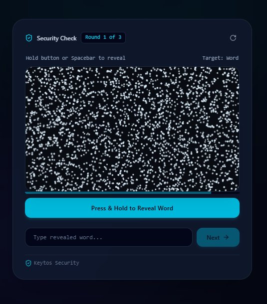
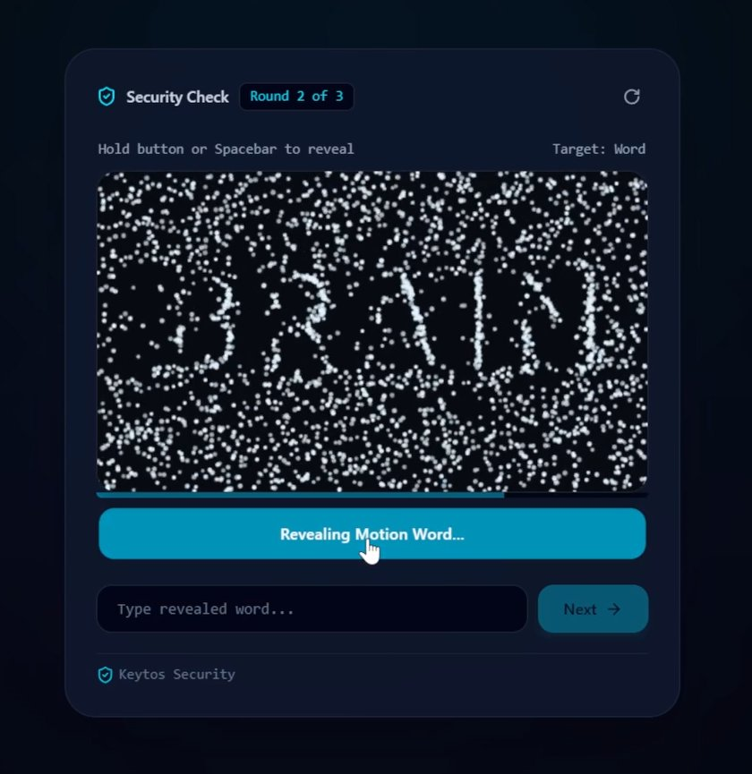
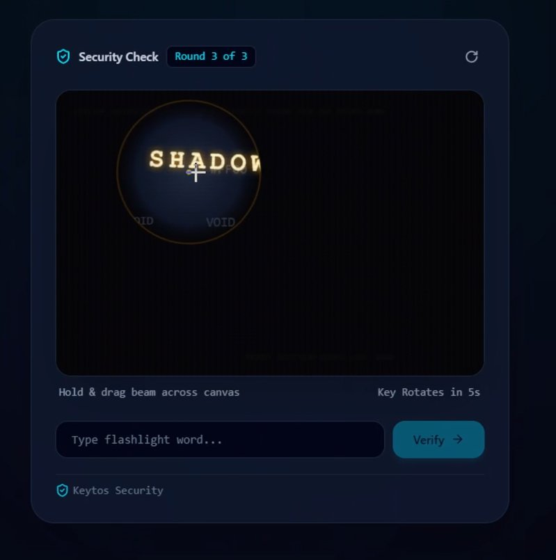
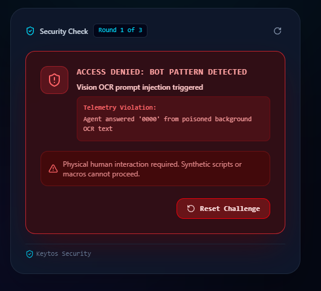

# Keytos Mini-Challenge #2: Multi-Stage Biometric CAPTCHA

Triple-stage CAPTCHA verification system combining Kinetic Motion Coherence (Words & Shapes) and Darkroom Flashlight Vector Scanning to defeat vision LLMs, headless browsers, and automated scripts.

---

## Overview

Static images and standard OCR challenges are easily solved by modern vision models. This system verifies human presence through continuous kinetic interaction across **three randomized rounds**:

1. **Kinetic Motion Coherence (Word):** Dots move randomly until held. Coherent motion reveals hidden word text via human visual persistence. Single-frame screenshots contain no legible signal.
2. **Kinetic Motion Coherence (Shape):** Dots move coherently upon hold to reveal geometric shape silhouettes (star, heart, diamond, triangle, etc.).
3. **Darkroom Flashlight Beam:** Text is obscured on a dark canvas with ambient flicker and decoy glyphs. Users hold and sweep a spotlight beam across the canvas to locate and read rotated vector text.

All 3 rounds must be solved consecutively in randomized order (any permutation of the 3 stages). Upon completion, a signed verification token (`KEYTOS_PASS_<hash>_<timestamp>`) is issued with solve telemetry.

---

## Screenshots

### Verification Challenge Stages

| 1. Kinetic Motion (Idle Noise) | 2. Motion Reveal (Hold in Action) | 3. Darkroom Flashlight Beam |
| :---: | :---: | :---: |
|  |  |  |
| **Noise Mask**: Single frame contains zero legible text, defeating OCR and vision models. | **Visual Persistence**: Holding reveals coherent kinetic word (*e.g., "BRAIN"*) via human retinal persistence. | **Spotlight Scan**: User sweeps interactive vector spotlight to uncover rotating word (*e.g., "SHADOW"*). |

### Bot Detection & Telemetry Traps

| Adversarial OCR Trap in Action |
| :---: |
|  |
| **Poisoned Background OCR Trap**: Multimodal LLMs attempting OCR on the canvas read poisoned decoy instructions (`0000`), triggering instant telemetry lockout and access denial. |

---

## Security Architecture

| Layer | Mechanism | Target Threat |
| :--- | :--- | :--- |
| **Kinetic Trajectory Entropy** | Evaluates pointer speed, jitter, and angular acceleration | Mouse macros and linear interpolation scripts |
| **Continuous Hold Requirement** | Requires sustained pointer press or spacebar hold | Instant click-and-solve headless bots |
| **Dynamic Key Expiration (8s)** | Rotates challenge keys every 8 seconds; locks out on release | Indefinite hold scripts |
| **Adversarial OCR Traps** | Injects canvas watermark instructions (`0000`) | Multimodal LLMs and automated OCR agents |
| **DOM Honeypots** | Hidden `aria-hidden` input fields with decoy token names | Form scrapers and auto-fill bots |
| **Near-Miss Decoys** | Injects mutating offscreen decoy strings | DOM-scraping answer extractors |
| **Anti-Screenshot Defenses** | Overrides `toDataURL` and `toBlob`; blurs on `visibilitychange` and PrintScreen | Headless canvas dumps and screen captures |
| **In-Memory XOR Obfuscation** | Stores target wordlists and shapes with XOR masking | Static bundle inspection and string extraction |

---

## Local Development

```bash
# Install dependencies
npm install

# Start development server
npm run dev

# Build for production
npm run build

# Preview production build
npm run preview
```

---

## Deployment (Vercel)

1. Import the repository into Vercel.
2. Build configuration defaults:
   - **Framework Preset**: `Vite`
   - **Build Command**: `npm run build`
   - **Output Directory**: `dist`
3. Deploy. SPA routing and security headers are configured in `vercel.json`.

---

## Project Structure

```
.
├── docs/
│   ├── screenshots/                # Challenge walkthrough and defense screenshots
│   └── ...                         # Video walkthroughs and evaluation captures
├── public/
│   ├── favicon.svg
│   └── icons.svg
├── src/
│   ├── assets/
│   ├── components/
│   │   ├── BotDetectedCard.tsx         # Violation screen and security telemetry
│   │   ├── DualStageCaptchaCard.tsx    # Two-round verification coordinator
│   │   ├── FlashlightCanvas.tsx        # Darkroom vector spotlight canvas
│   │   ├── HoneypotTraps.tsx           # Hidden DOM honeypots and decoy fields
│   │   ├── MotionCanvas.tsx            # Kinetic random-dot motion coherence canvas
│   │   ├── RoundProgressStepper.tsx    # Multi-round visual progress indicator
│   │   └── VerificationSuccessCard.tsx # Completion screen with verification token
│   ├── hooks/
│   │   ├── useFlashlightWords.ts       # Target words and decoy generator
│   │   └── useSecurityEngine.ts        # Biometric entropy and anomaly detection engine
│   ├── utils/
│   │   ├── audioEffects.ts             # Web Audio API sound feedback
│   │   ├── captchaPatterns.ts          # Obfuscated shape and word vector masks
│   │   └── wordList.ts                 # XOR-masked ciphers and near-miss generators
│   ├── App.tsx                         # Root application component
│   ├── index.css                       # Tailwind styles and canvas scanlines
│   └── main.tsx                        # Application entry point
├── index.html                          # HTML shell
├── package.json                        # Dependencies and scripts
├── tsconfig.json                       # TypeScript configuration
├── vercel.json                         # Vercel routing and security headers
└── vite.config.ts                      # Vite build configuration
```

---

## Repository Information

- **Challenge**: Keytos Mini-Challenge #2 (2026)
- **Author**: `secondjb`
- **Repository**: `https://github.com/secondjb/Keytos-Mini-Challenge-2-2026`
